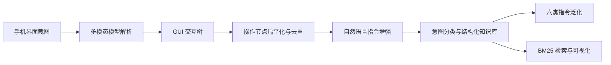

# GUI 操作知识库与指令泛化 Agent

面向手机 GUI Agent 的知识构建项目，将应用界面中的操作入口、交互路径与功能语义转化为可检索的操作知识，并生成多种自然语言指令表述。

项目由 **GUI 交互树采集** 与 **知识库构建及指令增强** 两部分组成，连接界面理解、操作节点整理、意图归类和指令泛化。

## 解决的问题

- 手机应用的操作入口分散在多层页面，界面结构难以直接用于自然语言检索。
- 同一操作具有多种表达方式，需要将用户语言与具体操作路径关联。
- 采集和模型增强过程可能中断，需要保存中间结果并恢复任务。

## 系统流程



## 核心模块

| 模块 | 主要职责 |
| --- | --- |
| GUI 采集 | 通过 ADB 获取截图，结合多模态模型识别界面元素、功能与预期变化 |
| 探索调度 | 使用深度优先遍历组织探索，由人工处理页面导航和特殊交互 |
| 树解析 | 提取节点、动作和完整路径，基于节点名称、动作、路径去重 |
| 语义增强 | 为操作节点生成自然语言指令与意图关键词 |
| 意图结构化 | 按用户目标归组，并将意图标签回写到扁平知识库 |
| 指令泛化 | 生成清晰、同义、模糊、含噪、多步依赖及跨应用表述 |
| 检索与展示 | 使用 jieba 分词及 BM25 检索，支持知识浏览和报表导出 |

## 设计要点

**分阶段处理。** 采集、解析、增强和结构化分别保存中间产物，便于定位问题和增量更新。

**单屏与多屏采集。** 单屏解析用于功能入口，多屏增量解析用于长列表，并参考已识别内容去重。

**可恢复任务。** 采集保存探索状态，增强阶段保存处理进度；重试与退避用于缓解模型调用失败。

**语言覆盖。** 六类表述覆盖常规请求、口语、省略、输入噪声及复合任务。跨应用与多步骤指令属于生成的数据类型，不代表已验证的自动执行能力。

## 数据格式示例

以下为说明字段关系而编写的示例，不来自真实采集记录：

```json
{
  "node_name": "添加闹钟",
  "node_type": "button",
  "action_type": "click",
  "path_str": "时钟 > 闹钟 > 添加闹钟",
  "description": "进入新建闹钟页面",
  "generated_queries": ["新建一个闹钟", "帮我添加闹铃"],
  "intent_keywords": ["闹钟", "添加"],
  "intent_name": "设置闹钟"
}
```

## 项目记录的规模

原设计文档记录了 47 个应用、5,285 个操作节点、321 个意图分类和 37,166 条基础指令。上述数字是历史文档中的统计，当前仓库未附原始数据，未独立复核；约 95,000 条泛化变体为按每节点 18 条推算的规模，不作为实测完成量。

## 文档导航

- [GUI 采集系统设计](docs/gui-collection.md)：截图解析、探索调度、数据结构与持久化。
- [知识库构建系统设计](docs/knowledge-pipeline.md)：扁平化、语义增强、意图分类、泛化与检索。

## 仓库内容与使用

本仓库是项目介绍与设计文档仓库，当前不包含完整 Python 源码、原始采集数据和部署配置，因此不提供运行命令。文档中的脚本名称用于说明原系统的模块职责。

阅读顺序建议为：本页概览 → GUI 采集设计 → 知识库处理流水线。
